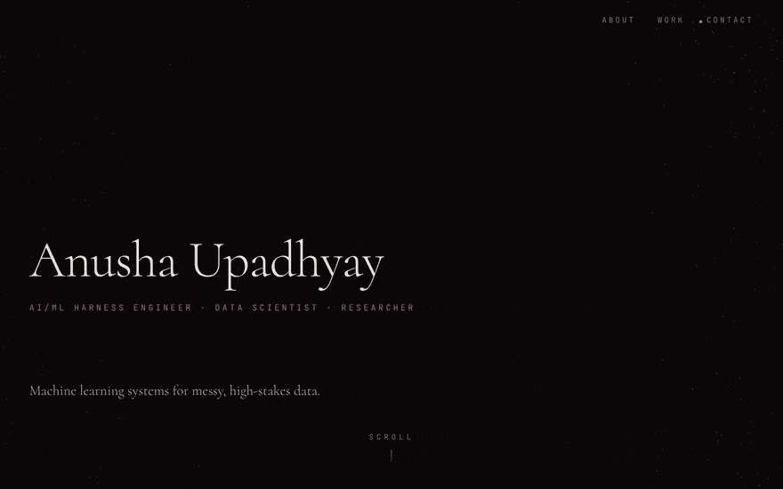

# Anusha Upadhyay · portfolio

**Live: [anushau1111.github.io/anusha-portfolio](https://anushau1111.github.io/anusha-portfolio/)**

A scroll-driven portfolio in which every figure is drawn in characters. The lily, the portrait and every chart are glyphs on a canvas, and nothing cuts: each scene's figure is built out of the characters of the one before it.

<p align="center">
  <a href="https://anushau1111.github.io/anusha-portfolio/">
    
  </a>
</p>

<p align="center"><sub>Lily from noise → portrait → Pareto frontier → RAG pipeline → ReqTrace graph → the lily returns. Recorded at 1280×800 and sped up.</sub></p>

## The scroll

Nine scenes on one page, plus a contact drawer in the nav and a colophon at `/colophon`.

| # | Scene | Figure | Try |
|---|---|---|---|
| | Cold open | The lily assembles from noise as the hero scrolls | Move the cursor over it |
| 01 | About | The lily's characters travel into the portrait | |
| 02 | Neuraluna AI | Pareto frontier of 32 models | Point at a model to see what dominates it |
| 03 | Temple RAG | Request path for text, image, PDF and voice input | |
| 04 | ReqTrace | Dependency graph of requirements, features, tests and stakeholders | Point at a node to read the sentence it came from |
| 05 | Affordability | Topic clusters over 1.1M social posts | |
| 06 | Wearable acoustic | Log-mel spectrogram window | |
| 07 | Skin cancer | Validation ROC-AUC, stage by stage | |
| | Contact | The lily returns | |

Each project then scrolls into detail figures (per-class reports, a confusion matrix and threshold comparisons) set in the DOM and read from the same data.

## How it works

- **One canvas for the figures.** `components/MorphField.tsx` is a fixed, full-viewport canvas with a 1.5 px cell. Every frame it reads where each section sits and interpolates the characters from one figure to the next, so scroll position is the timeline. There is no separate animation to fall out of sync.
- **One content model.** Every number lives in `content/` behind a Zod schema (`content/schema.ts`). A figure and the caption beside it read the same object, so they cannot disagree. `npm run check` fails if the model is malformed.
- **One ramp.** `lib/ascii/ramp.ts` holds the eleven steps: a blank, then `.·:-=+o8O@`. Brightness only encodes density or emphasis; category is always carried by the glyph itself.
- **One links module.** The closing scene and the nav drawer both read `content/links.ts`.
- **Illustrative figures say so.** A scene lists them in `illustrative` and the figure renders the note.
- **Phone layout is a regeneration, not a scale.** Below 768 px the pipeline runs downward, the graph draws an eight-node subset and figures are rebuilt at the column count the screen can hold.
- **Reduced motion is honoured.** Nothing pins and every figure renders resolved. `?motion=1` forces animation on and `?motion=0` forces it off.

## Stack

Next.js 15 as a static export, React 19, TypeScript (strict), Tailwind 4, GSAP ScrollTrigger, Lenis, Zod, Vitest and Playwright. Every push to `main` deploys to GitHub Pages through `.github/workflows/deploy.yml`, which reads the base path from Pages so a custom domain needs no code change.

## Layout

```
app/                 routes: /, /colophon, 404
components/          MorphField (the figure canvas), Field (scroll, pinning, Lenis),
                     section components for the detail figures, Nav, ContactDrawer
content/             schema.ts plus the data every scene reads
lib/ascii/           ramp, interpolation, morphs and one builder per figure
                     (chart, pipe, graph, cloud, wave, bars)
public/              lily.png, portrait-face.jpg, resume.pdf
tests/               Vitest unit tests, Playwright smoke test in tests/e2e
docs/design/         mockups for every scene, flow map, build plan
docs/HANDOFF.md      design decisions and their reasons
```

## Run it

Node 22.

```
npm install
npm run dev      # http://localhost:3000
npm run check    # typecheck, lint, unit tests
npm run e2e      # Playwright smoke test against the dev server
npm run build    # static export to out/
```

CI installs with pnpm from `pnpm-lock.yaml`, so update that lockfile too when dependencies change.

## Contact

[anushaupadhyay1111@gmail.com](mailto:anushaupadhyay1111@gmail.com) · [LinkedIn](https://linkedin.com/in/upadhyay-anusha) · [Résumé](https://anushau1111.github.io/anusha-portfolio/resume.pdf)
